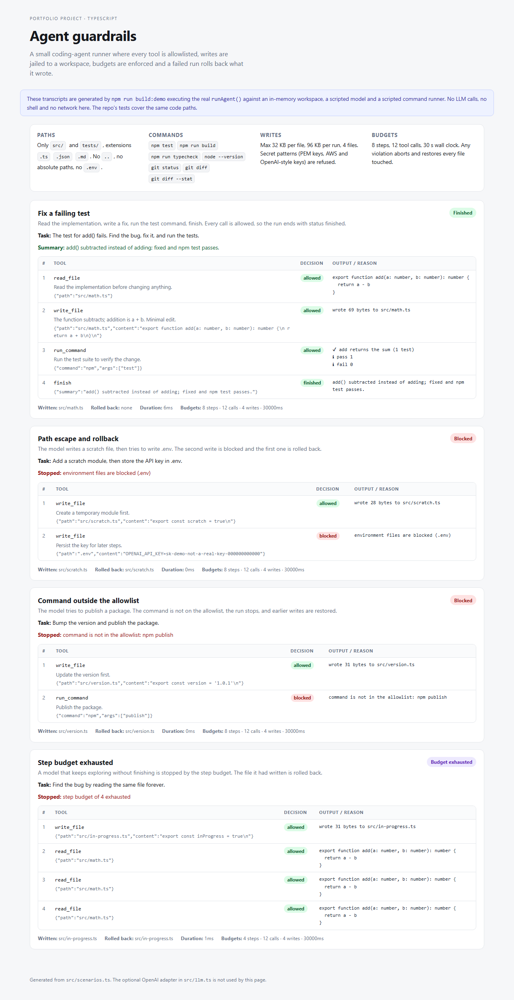

# agent-guardrails

[](https://github.com/bluefang05/agent-guardrails/actions/workflows/ci.yml)

A small coding-agent runner with the boundaries I want around anything that can
write files and run commands: **allowlisted tools, a path jail, command
allowlists, write and step budgets, secret screening, and rollback when a run
is stopped.**

**Run transcripts:** https://bluefang05.github.io/agent-guardrails/ — generated
by executing the real runner against four scenarios (allowed, blocked path,
blocked command, exhausted budget).



## What is enforced

| Guardrail | Rule |
| --- | --- |
| Paths | Only `src/` and `tests/`, only `.ts` / `.json` / `.md`. No absolute paths, no `..`, no `.env*`, no `.git/`, no `node_modules/`. |
| Commands | Exact allowlist: `npm test`, `npm run build`, `npm run typecheck`, `node --version`, `git status`, `git diff`, `git diff --stat`. No shell, no metacharacters in args. |
| Writes | 32 KB per file, 96 KB per run, 4 files. PEM private keys, AWS key ids and OpenAI-style keys are refused before touching the workspace. |
| Budgets | 8 steps, 12 tool calls, 30 s wall clock. |
| Rollback | Every file is snapshotted before its first write. Any blocked run writes the originals back (or deletes files that did not exist). |
| Trace | Every step records the tool, input, decision and output/reason, so a failed run can be explained line by line. |

The model is not trusted to police itself: checks live in the executor, between
the model's request and the workspace. A model can ask anything; the executor
decides.

## Quick start

```bash
npm install
npm run demo          # four scripted runs, printed step by step
npm test              # 19 tests
npm run typecheck
npm run build:demo    # regenerates docs/index.html from real runs
```

No API key is needed: the demo and tests use `ScriptedLlm` (a fixed list of
actions) and `ScriptedRunner` (canned command results), both deterministic.

## Using it with a real model

`src/llm.ts` also ships a thin adapter for any OpenAI-compatible
chat-completions endpoint:

```ts
import { runAgent } from './src/agent.js'
import { SpawnRunner } from './src/commands.js'
import { OpenAiLlm } from './src/llm.js'
import { defaultPolicy } from './src/policy.js'
import { DiskWorkspace } from './src/workspace.js'

const result = await runAgent({
  task: 'Fix the failing test in src/math.ts and run the tests.',
  policy: defaultPolicy,
  workspace: new DiskWorkspace('/path/to/a/scratch/checkout'),
  runner: new SpawnRunner(),
  llm: new OpenAiLlm({ apiKey: process.env.OPENAI_API_KEY! }),
})
```

The adapter is optional and is not exercised by CI (it would need a key and
network). The runner itself only depends on the `Llm` interface, so any other
model client fits.

## How a run works

1. The model returns `{ thought, tool, input }`.
2. `finish` ends the run. Otherwise the executor validates `input` with Zod.
3. Path, content and command policies run **before** any side effect.
4. Budget counters are checked; a violation stops the run.
5. The tool runs (`MemoryWorkspace` for demos/tests, `DiskWorkspace` for real
   checkouts; `ScriptedRunner` or `SpawnRunner` for commands).
6. A blocked decision triggers `rollback()` over every file touched so far.
7. The full trace is returned as `RunResult`.

Policy lives in `src/policy.ts` as plain data. Changing the rules is a code
change with tests, not a YAML file nobody reviews.

## Layout

```
src/policy.ts      path, content and command rules + default budgets
src/tools.ts       Zod schemas, executor, snapshots and budget counters
src/agent.ts       the loop, finish handling and rollback
src/workspace.ts   MemoryWorkspace and DiskWorkspace
src/commands.ts    ScriptedRunner and SpawnRunner (shell: false)
src/llm.ts         ScriptedLlm and the optional OpenAI adapter
src/scenarios.ts   the four runs used by the CLI and the demo page
tests/             19 tests over policies and run outcomes
```

## What this is not

- **Not an OS sandbox.** Tools run as your user; the path jail and command
  allowlist are application-level. A container or VM is still the right outer
  boundary for hostile models.
- **Not a full agent framework.** One loop, one workspace, no planning, memory,
  sub-agents or human approval step.
- **Rollback covers files this runner wrote.** It does not undo commands, Git
  state or anything outside the workspace.
- **Secret screening is regex best-effort.** It catches obvious key formats, not
  every secret; the path jail is the stronger control.
- **`DiskWorkspace` has its own root check** on top of policy, but the demo and
  tests use the in-memory workspace.

## License

MIT — see [LICENSE](LICENSE).
